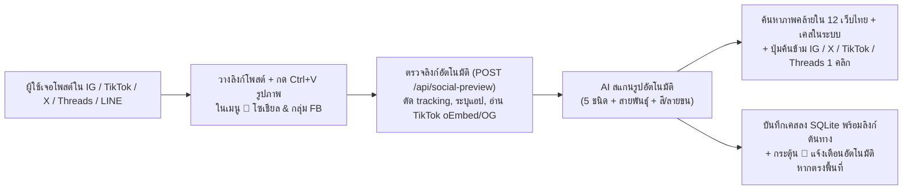
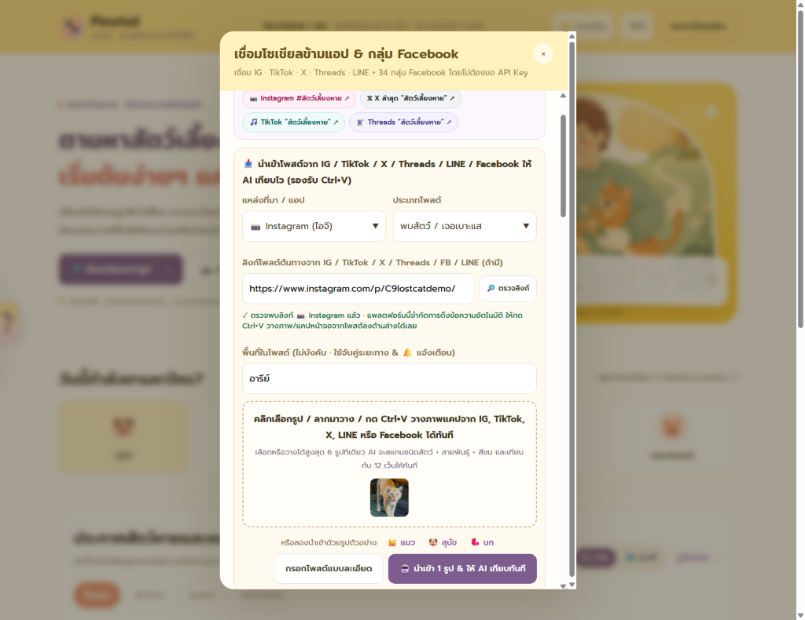
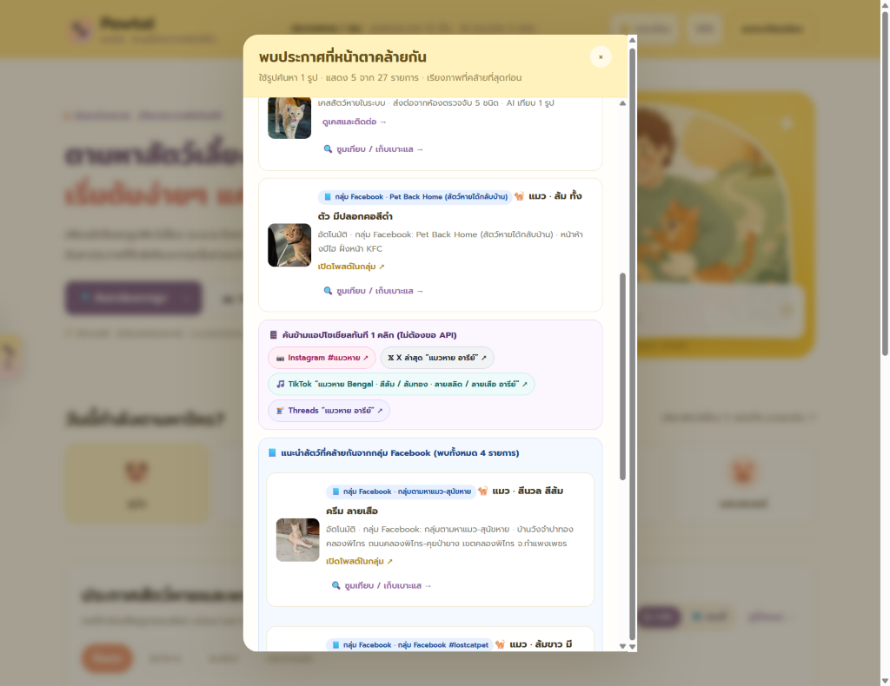
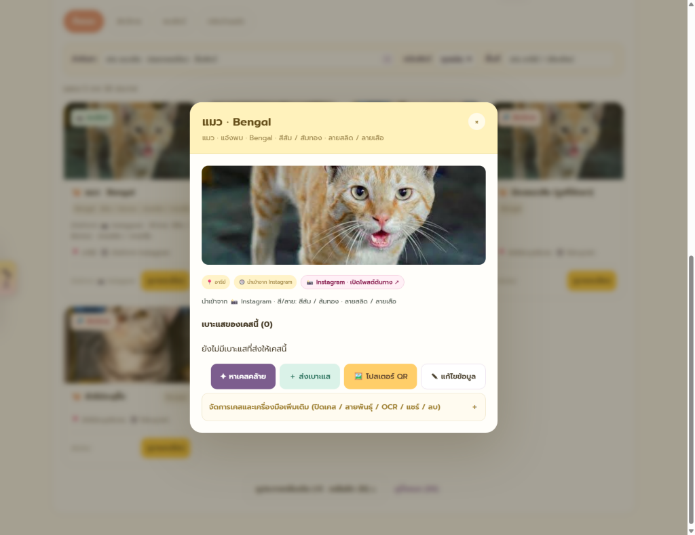

# คู่มือระบบเชื่อมโซเชียลข้ามแอปแบบไม่ต้องขอ API (IG · X · TikTok · Threads · LINE + 34 กลุ่ม FB)

เอกสารนี้อธิบายการทำงานและสาธิตการใช้งานจริงของฟีเจอร์ **เชื่อมโซเชียลข้ามแอป (Zero-API-Key Cross-App Social Bridge)** ในโปรเจกต์ **Pawtal (พอลทัล)** ที่สร้างขึ้นเพื่อให้ครอบคลุมประกาศสัตว์หายใน **Instagram, X (Twitter), TikTok, Threads, LINE และ Facebook** โดยไม่ต้องสมัคร Developer Account หรือรอการอนุมัติ App Review

---

## 1. ทำไมออกแบบเป็นแบบ "ไม่ต้องขอ API Key"?

แพลตฟอร์มโซเชียลอย่าง **Instagram, TikTok, X และ Threads** ไม่อนุญาตให้เว็บไซต์ภายนอกดึงฟีดโพสต์สาธารณะอัตโนมัติหากไม่มีสิทธิ์ Business API / App Review การฝืนดึงข้อมูลโดยตรง (scraping) มีความเสี่ยงสูงที่จะติดหน้า Login หรือถูกบล็อก IP ระหว่างใช้งานจริง

**Pawtal** จึงใช้วิธีเชื่อมแบบ **Hybrid Zero-Auth** ที่เสถียร 100% และไม่ละเมิดข้อกำหนดแพลตฟอร์ม:

---

## 2. สาธิตการใช้งานจริงทีละขั้น (3 ขั้นตอนพร้อมภาพจริง)

### ขั้นที่ 1 — เปิดเมนู "🔗 โซเชียล & กลุ่ม FB" และนำเข้าโพสต์จาก Instagram

- กดปุ่ม **🔗 โซเชียล & กลุ่ม FB** จากแถบเมนูลัดด้านซ้าย
- ด้านบนสุดมีแถบ **ค้นหาข้ามแอปโซเชียลทันที 1 คลิก** สำหรับเปิดดูประกาศใน **Instagram, X (Live), TikTok และ Threads**
- ในช่องวางลิงก์ เมื่อวางลิงก์ Instagram เช่น `https://www.instagram.com/p/C9lostcatdemo/?igsh=abc123` แล้วกด **🔎 ตรวจลิงก์**:
  1. ระบบสลับช่องแหล่งที่มาเป็น **📸 Instagram (ไอจี)** ให้อัตโนมัติ
  2. ตัดพารามิเตอร์ติดตาม (`?igsh=abc123`) ออกให้เหลือลิงก์สะอาด `https://www.instagram.com/p/C9lostcatdemo/`
  3. สำหรับลิงก์ **TikTok** ระบบจะเรียก public oEmbed อ่านหัวข้อโพสต์ + ชื่อบัญชี + ดึงคำพื้นที่มาเติมให้ด้วย ส่วนแอปที่ล็อกหน้า Login (เช่น Instagram) จะขึ้นข้อความสีเขียวแจ้งเตือนอย่างชัดเจนว่าให้กด **`Ctrl+V`** วางภาพแคปจากโพสต์ลงในกล่องด้านล่างได้เลย
- ใส่พื้นที่ (เช่น `อารีย์`) เพื่อใช้จัดอันดับระยะทางและเชื่อมกับระบบ **🔔 แจ้งเตือน** แล้ววางรูป (หรือกดปุ่มรูปตัวอย่าง `🐱 แมว / 🐶 สุนัข / 🐦 นก` สำหรับสาธิตไว) จากนั้นกด **🤖 นำเข้า 1 รูป & ให้ AI เทียบทันที**

---

### ขั้นที่ 2 — AI วิเคราะห์ภาพ ค้นหา 12 เว็บ + แสดงปุ่มค้นข้าม IG / X / TikTok / Threads 1 คลิก

- ระบบนำภาพที่นำเข้าจาก Instagram ไปสแกนชนิดสัตว์ (`แมว`), สายพันธุ์ (`Bengal`), และสี/ลายขน (`สีส้ม / ส้มทอง · ลายสลิด / ลายเสือ`) แล้วค้นหาประกาศที่หน้าตาคล้ายกันจาก **เคสในระบบ + 12 เว็บสาธารณะไทย + กลุ่ม Facebook (ผ่าน Pawsociety)**
- ใต้รายการผลลัพธ์จะมีแถบ **📱 ค้นข้ามแอปโซเชียลทันที 1 คลิก (ไม่ต้องขอ API)** ซึ่งสร้างคำค้นจากข้อมูลที่ AI เพิ่งวิเคราะห์ให้อัตโนมัติ:
  - **📸 Instagram `#แมวหาย`** → เปิดแท็ก `#แมวหาย` / `#หมาหาย` / `#นกหาย` / `#กระต่ายหาย` / `#แฮมสเตอร์หาย`
  - **𝕏 X ล่าสุด “แมวหาย อารีย์”** → เปิดค้น X แบบเรียงโพสต์ล่าสุด (`&f=live`)
  - **🎵 TikTok “แมวหาย Bengal ... อารีย์”** → เปิดค้นคลิปประกาศสัตว์หายใน TikTok
  - **🧵 Threads “แมวหาย อารีย์”** → เปิดค้นโพสต์ชุมชน Threads
- กดปุ่มไหนก็เด้งไปยังหน้าค้นหาของแอปนั้นได้ทันที (บนมือถือจะเปิดตรงเข้าแอปที่ติดตั้งไว้)

---

### ขั้นที่ 3 — เคสที่นำเข้าเก็บลิงก์ต้นทางพร้อมป้ายแพลตฟอร์ม กดย้อนกลับไปโพสต์ IG ได้ทันที

- โพสต์ที่นำเข้าจะถูกบันทึกเป็นเคสในฐานข้อมูล SQLite พร้อมข้อมูลที่ AI วิเคราะห์ไว้ครบ (`แมว · Bengal · สีส้ม / ส้มทอง · ลายสลิด / ลายเสือ`, `📍 อารีย์`, `🕒 นำเข้าจาก Instagram`)
- มีป้ายสีชมพู **📸 Instagram · เปิดโพสต์ต้นทาง ↗** ที่กดเปิดกลับไปยังโพสต์ Instagram ต้นทางเพื่อติดต่อเจ้าของโพสต์ได้ทันที
- หากมีเจ้าของสัตว์ตั้งกฎ **🔔 แจ้งเตือน** ไว้ตรงกับชนิดและพื้นที่นี้ (เช่น `แมว · อารีย์`) ระบบแจ้งเตือนจะเด้งขึ้นอัตโนมัติด้วย

---

## 3. สรุปความสามารถและไฟล์ที่พัฒนา

| ไฟล์ | หน้าที่หลัก |
|---|---|
| `social-links.mjs` | โมดูลกลาง (Zero-dependency) สำหรับตรวจแพลตฟอร์ม (`Instagram, TikTok, X, Threads, LINE, Facebook`), ตัดพารามิเตอร์ tracking, สร้างลิงก์ค้นข้ามแอป 1 คลิก และอ่าน metadata สาธารณะแบบป้องกัน SSRF |
| `server.mjs` | เพิ่ม `POST /api/social-preview` (จำกัดอัตราเรียก + allowlist โดเมนสาธารณะ + ดึงคำพื้นที่/เบอร์โทรจากข้อความตัวอย่าง) และอนุญาตเสิร์ฟ `social-links.mjs` |
| `matching.js` | เพิ่มแถบ **📱 ค้นข้ามแอปโซเชียลทันที 1 คลิก** ในหน้าผลลัพธ์ AI และแสดงป้ายแพลตฟอร์ม (`📸 Instagram`, `🎵 TikTok`, `𝕏 X`, `🧵 Threads`, `💚 LINE`) บนการ์ดผลลัพธ์ |
| `app.js` + `index.html` + `readable-ui.css` | อัปเกรดหน้าต่าง **เชื่อมโซเชียลข้ามแอป & กลุ่ม Facebook**, ช่องตรวจลิงก์อัตโนมัติ, การนำเข้าแบบ `Ctrl+V` / รูปตัวอย่าง และป้ายลิงก์ต้นทางในหน้ารายละเอียดเคส |
| `tests/social-links.test.mjs` | ชุดทดสอบอัตโนมัติ 4 กรณี (ตรวจแพลตฟอร์ม/SSRF, สร้างลิงก์ 5 ชนิด, TikTok oEmbed + IG fallback, การเรนเดอร์ใน `matching.js`) — รันรวมทั้งโปรเจกต์ผ่าน **83 / 83** |

---

## 4. สคริปต์สั้นๆ สำหรับตอบคำถามอาจารย์ (30 วินาที)

> *"สำหรับโซเชียลอย่าง Instagram, TikTok, X และ Threads ที่ปิดไม่ให้เว็บนอกดึงฟีดอัตโนมัติโดยไม่มีสิทธิ์ Business API เราแก้ปัญหาด้วยวิธี Zero-API-Key 2 ทางควบคู่กันครับ: หนึ่งคือหลัง AI สแกนรูปเสร็จ ระบบจะสร้างปุ่มค้นข้ามแอป 1 คลิกด้วยคีย์เวิร์ดไทยและพื้นที่ที่ AI วิเคราะห์ได้ทันที และสองคือถ้าผู้ใช้เห็นโพสต์ใน IG หรือ TikTok ก็วางลิงก์พร้อมกด Ctrl+V แคปภาพลงใน Pawtal เพื่อให้ AI เทียบกับประกาศจาก 12 เว็บไทยและกระตุ้นระบบแจ้งเตือนได้ทันที โดยไม่ละเมิดข้อกำหนด API ของแพลตฟอร์มครับ"*
